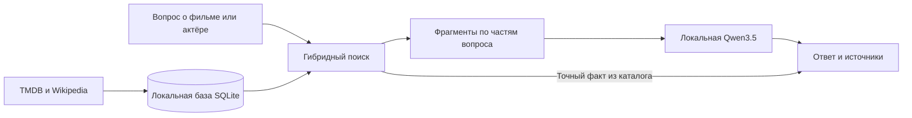

<p align="center">
  
</p>

<p align="center">
  <strong>Поиск по фильмам, сериалам и актёрам с ответами на русском.</strong><br>
  От названия фильма до конкретной сцены, роли или факта биографии.
</p>

<p align="center">
  <a href="demo/movie-rag-demo.mp4"><strong>▶ Смотреть демо</strong></a> ·
  <a href="#features">Возможности</a> ·
  <a href="#architecture">Как устроено</a> ·
  <a href="#start">Быстрый запуск</a>
</p>

<a id="features"></a>
## От вопроса к источнику

| 01 · Найти | 02 · Спросить | 03 · Проверить |
| :-- | :-- | :-- |
| Выберите фильм, сериал или актёра по подсказкам с постерами и годом выпуска. | Спросите о развязке, роли или биографии. Составной вопрос разбирается по частям. | Откройте ссылку рядом с фактом и прочитайте фрагмент, на который опирался ответ. |

<p align="center">
  <a href="demo/movie-rag-demo.mp4">
    
  </a>
  <br><sub>Интерфейс Киноархива · нажмите на скриншот, чтобы открыть видео</sub>
</p>

### Вопросы для первого запуска

| Выберите | Спросите |
| :-- | :-- |
| **Матрица** | Какую таблетку выбрал Нео и что он узнал? |
| **Шоу Трумана** | Почему Труман боялся воды и как выбрался из шоу? |
| **Джейсон Стейтем** | Чем он занимался до кино и как получил первую роль? |

<a id="architecture"></a>
## Как устроен Киноархив



**Сбор и поиск.** Материалы загружаются при первом выборе фильма или человека. В базе SQLite хранятся название, URL, текст и дата получения. Текст разбивается на фрагменты по 480 слов с перекрытием 80. BM25 ищет по словам, а в расширенном режиме MiniLM дополняет выдачу поиском по смыслу. Для каждой части вопроса сервис отбирает свой набор фрагментов и сохраняет соседние предложения из той же статьи, даже когда сцена пересекает границу фрагмента.

**Ответ.** На точные вопросы о ролях, режиссёрах и композиторах сервис отвечает прямо по каталогу TMDB. Сюжет и биографию объясняет Qwen через Ollama. FastAPI отдаёт текст по мере генерации и связывает цитаты с карточками источников.

<a id="start"></a>
## Быстрый запуск

### Демо для проверяющего

Нужен **Python 3.11+**. Ключи и Ollama для демо не нужны. При первом запуске сервис сам создаст базу и добавит пять подготовленных материалов со ссылками на Wikipedia.

```bash
git clone https://github.com/dud0k3/movie-rag.git
cd movie-rag
python3 -m venv .venv
source .venv/bin/activate
python -m pip install -e .
python -m uvicorn movie_rag.app:app
```

На Windows используйте `py -m venv .venv` и `.venv\Scripts\Activate.ps1` вместо команд создания и активации среды выше.

**[Открыть Киноархив](http://127.0.0.1:8000/)** · [Интерактивное API](http://127.0.0.1:8000/docs)

Введите **Матрица**, выберите фильм и спросите: **«Какую таблетку выбрал Нео и что она ему позволила узнать?»**. Демо использует BM25 и возвращает короткую выжимку с источником. После установки зависимостей интерфейс и поиск работают локально. Оригиналы статей открываются по ссылкам в интернете.

| Метод API | Что можно проверить |
| :-- | :-- |
| `POST /ingest` | Обновить материал из Wikipedia, отправив `{"type":"movie","id":603,"refresh":true}`. Для обновления нужен интернет. |
| `GET /search` | Найти фрагменты по `q=красная таблетка`. В выдаче есть оценки и ссылки. |
| `GET /ask` | Получить ответ с источниками по `q=Какую таблетку выбрал Нео?`, `entity_type=movie`, `entity_id=603`. |

<details>
<summary><strong>Расширенный режим с TMDB, MiniLM и Qwen</strong></summary>

Скопируйте `.env.example` в `.env` и заполните `TMDB_API_KEY` или `TMDB_READ_ACCESS_TOKEN`. В `WIKIMEDIA_CONTACT_URL` можно указать ссылку на профиль GitHub. Установите и запустите [Ollama](https://ollama.com/download), затем выполните:

```bash
python -m pip install -e '.[semantic]'
ollama pull qwen3.5:9b
python -m uvicorn movie_rag.app:app
```

С ключом поиск охватывает каталог TMDB. Сервис загружает статьи Wikipedia по мере выбора объекта и передаёт подходящие фрагменты локальной Qwen. Если модель недоступна, остаётся режим выжимки.

</details>

---

Учебный проект для **VK Education**. Источники данных — [TMDB](https://www.themoviedb.org/) и [Wikipedia](https://www.wikipedia.org/).

<sub>This product uses the TMDB API but is not endorsed or certified by TMDB.</sub>
