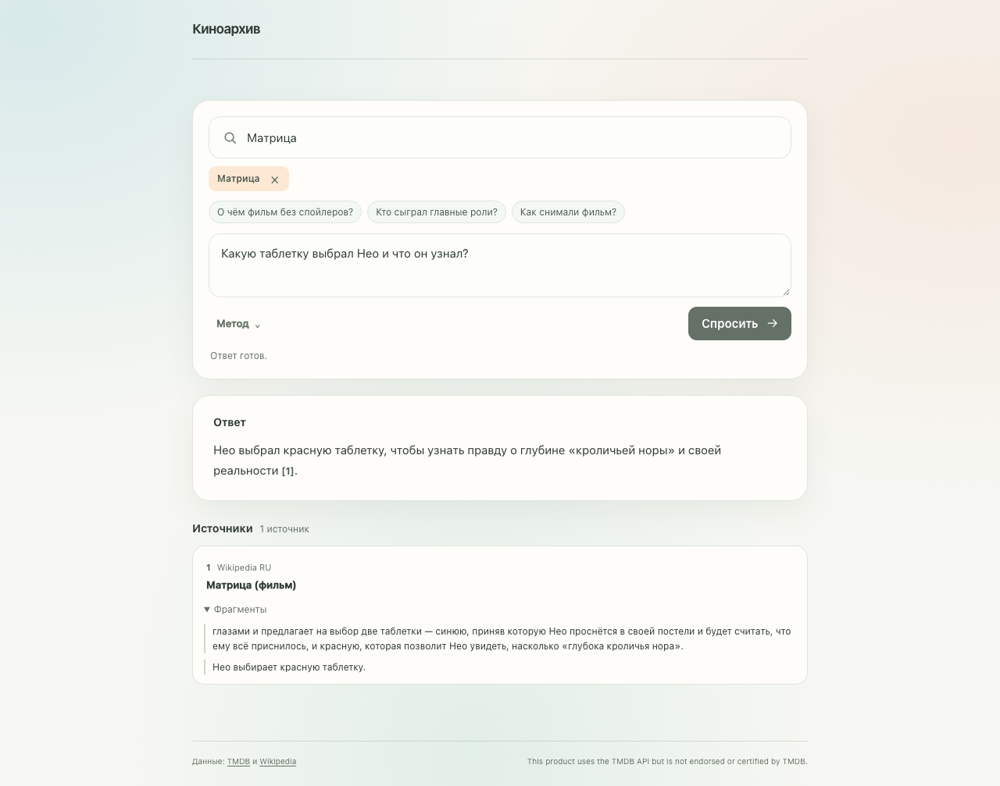
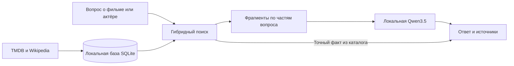

<p align="center">
  
</p>

<p align="center">
  <strong>Поиск по фильмам, сериалам и актёрам с ответами на русском.</strong><br>
  От названия фильма до конкретной сцены, роли или факта биографии.
</p>

<p align="center">
  <a href="demo/movie-rag-demo.mp4"><strong>▶ Смотреть демо</strong></a> ·
  <a href="#features">Возможности</a> ·
  <a href="#architecture">Как устроено</a> ·
  <a href="#start">Быстрый запуск</a>
</p>

<a id="features"></a>
## От вопроса к источнику

| 01 · Найти | 02 · Спросить | 03 · Проверить |
| :-- | :-- | :-- |
| Выберите фильм, сериал или актёра по подсказкам с постерами и годом выпуска. | Спросите о развязке, роли или биографии. Составной вопрос разбирается по частям. | Откройте ссылку рядом с фактом и прочитайте фрагмент, на который опирался ответ. |

<p align="center">
  <a href="demo/movie-rag-demo.mp4">
    
  </a>
  <br><sub>Интерфейс Киноархива · нажмите на скриншот, чтобы открыть видео</sub>
</p>

### Вопросы для первого запуска

| Выберите | Спросите |
| :-- | :-- |
| **Престиж** | Как Борден выполнял трюк с телепортацией? |
| **Шоу Трумана** | Почему Труман боялся воды и как выбрался из шоу? |
| **Джейсон Стейтем** | Чем он занимался до кино и как получил первую роль? |

<a id="architecture"></a>
## Как устроен Киноархив



**Сбор и поиск.** Материалы загружаются при первом выборе фильма или человека. BM25 находит совпадения по словам, MiniLM — по смыслу. Для каждой части вопроса сервис отбирает свой набор фрагментов и сохраняет соседние предложения, если они объясняют сцену.

**Ответ.** Имена режиссёров, композиторов и другие точные поля можно получить сразу из каталога. Сюжет и биографию объясняет Qwen через Ollama. FastAPI отдаёт текст по мере генерации и связывает цитаты с карточками источников.

<a id="start"></a>
## Быстрый запуск

Установите Python 3.11+ и [Ollama](https://ollama.com/download). Для загрузки материалов понадобится [ключ TMDB](https://developer.themoviedb.org/docs/getting-started).

```bash
git clone https://github.com/dud0k3/movie-rag.git
cd movie-rag
python3 -m venv .venv
source .venv/bin/activate
pip install -e .
cp .env.example .env
```

В `.env` заполните `TMDB_API_KEY` или `TMDB_READ_ACCESS_TOKEN`. Для `WIKIMEDIA_CONTACT_URL` подойдёт ссылка на ваш профиль GitHub.

```bash
ollama pull qwen3.5:9b
uvicorn movie_rag.app:app
```

**[Открыть Киноархив](http://127.0.0.1:8000/)** · [Интерактивное API](http://127.0.0.1:8000/docs)

В API доступны загрузка материалов (`POST /ingest`), поиск фрагментов с оценками и ссылками (`GET /search`) и ответ с источниками (`GET /ask`).

---

Учебный проект для **VK Education**. Источники данных — [TMDB](https://www.themoviedb.org/) и [Wikipedia](https://www.wikipedia.org/).

<sub>This product uses the TMDB API but is not endorsed or certified by TMDB.</sub>
