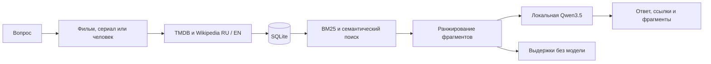

<p align="center">
  
</p>

<p align="center">
  <a href="https://github.com/dud0k3/movie-rag/actions/workflows/tests.yml"></a>
  
  
  
</p>

<p align="center">
  <strong>Русскоязычный поиск по фильмам, сериалам и людям кино.</strong><br>
  Спросите о развязке, роли или карьере актёра и откройте источник прямо из ответа.
</p>

<p align="center">
  <a href="demo/movie-rag-demo.mp4"><strong>▶ Демо</strong></a> ·
  <a href="#start"><strong>Запуск</strong></a> ·
  <a href="#architecture"><strong>Архитектура</strong></a> ·
  <a href="#quality"><strong>Замеры</strong></a> ·
  <a href="docs/answer-engine-research.md"><strong>Обзор 10 сервисов</strong></a> ·
  <a href="#api"><strong>API</strong></a>
</p>

<p align="center">
  <a href="demo/movie-rag-demo.mp4">
    
  </a>
</p>

## Что спросить

| Выберите в поиске | Задайте вопрос |
| :-- | :-- |
| 🎬 **Престиж** | Как Борден выполнял трюк с телепортацией? |
| 📺 **Слово пацана. Кровь на асфальте** | Кто такая Айгуль и как она связана с Маратом? |
| 🎭 **Джейсон Стейтем** | Каким видом спорта он занимался до кино? |

Можно выбрать фильм из каталога или указать точное название в кавычках. При совпадении названий выберите нужный год в меню. Первый выбор загружает доступные материалы, повторный использует локальную базу. Пока Qwen пишет ответ, он появляется по частям. После завершения можно открыть цитату и фрагменты, которые получила модель.

<a id="start"></a>
## Запуск

Нужны Python 3.11+, [ключ TMDB](https://developer.themoviedb.org/docs/getting-started) и интернет для первой загрузки материалов. Для генерации поставьте [Ollama](https://ollama.com/download).

```bash
git clone https://github.com/dud0k3/movie-rag.git
cd movie-rag
python3 -m venv .venv
source .venv/bin/activate
pip install -e .
cp .env.example .env
```

В `.env` заполните `TMDB_API_KEY` или `TMDB_READ_ACCESS_TOKEN`. В `WIKIMEDIA_CONTACT_URL` укажите ссылку на свой профиль или репозиторий. Файл `.env` исключён из Git. [Требования Wikimedia к User-Agent](https://foundation.wikimedia.org/wiki/Policy:Wikimedia_Foundation_User-Agent_Policy)

```bash
ollama pull qwen3.5:9b
uvicorn movie_rag.app:app
```

**[Открыть Киноархив](http://127.0.0.1:8000/)** · [Swagger UI](http://127.0.0.1:8000/docs)

Запись демо сделана в браузере с локальным сервером. [Сценарий записи](scripts/record_demo.py)

При недоступной Ollama сервис выдаёт выдержки из материалов. Если энкодер недоступен, можно выбрать BM25 в меню «Метод». Предварительная загрузка всего каталога не требуется.

<a id="architecture"></a>
## Архитектура



1. **Идентификация.** Каталог различает фильмы, сериалы и людей. При поиске статьи учитываются название, тип объекта и год выпуска. Русская и английская статьи загружаются параллельно.
2. **Поиск.** Документы режутся на фрагменты примерно по 480 слов с перекрытием 80. SQLite FTS5 даёт BM25, многоязычный MiniLM ищет по смыслу, а взвешенный RRF объединяет ранги. После отбора чанков сервис выбирает отдельные места, сохраняя заголовки разделов и соседние предложения там, где они поясняют сцену.
3. **Ответ.** Вопрос из нескольких частей запускает отдельный поиск по подтемам. Для каждой части есть место в контексте модели. Для точных полей каталога, включая режиссёра, композитора и число сезонов, генерация не нужна. Для разбора сюжета модель получает соседние предложения, чтобы сохранить порядок событий и связать причину с результатом.
4. **Проверка.** Перед показом финального текста проверяются номера ссылок и годы в цитируемых фрагментах. Повторный вопрос с тем же контекстом и моделью до 10 минут использует сохранённый ответ.

Подход к поиску и переранжированию основан на идеях [Contextual Retrieval](https://www.anthropic.com/research/contextual-retrieval). Короткий контекст учитывает эффект, описанный в работе [Lost in the Middle](https://aclanthology.org/2024.tacl-1.9/). Решения по составным запросам, длине ответов и ссылкам собраны в [обзоре 10 сервисов поиска](docs/answer-engine-research.md).

<a id="quality"></a>
## Проверка качества

**14 вопросов · MacBook Air M4 · прогретый Ollama · без кеша ответа**

| Метрика | До · 9B | Сейчас · 9B | Эксперимент · 4B |
| :-- | --: | --: | --: |
| Полностью пройденные проверки | 8/14 | 10/14 | 10/14 |
| Доля найденных в ответах ожидаемых фактов | 67% | 81% | 89% |
| Первый текст, p95 | 6.13 с | 5.08 с | 2.18 с |
| Готовый ответ, медиана | 5.28 с | 5.60 с | 2.63 с |
| Готовый ответ, p95 | 10.95 с | 15.47 с | 6.68 с |
| Прошли проверку и уложились в 5 с | 5/14 | 6/14 | 10/14 |

Проверки ищут ожидаемые факты, конкретные противоречия и корректный отказ на вопросы без ответа. Они не заменяют чтение ответа по источникам. На 14 примерах p95 равен самому медленному наблюдению. Время загрузки новых статей в замер не входит. Эксперимент с 4B проведён на предыдущей итерации нового поиска с той же базой и критериями. По умолчанию используется 9B. Для самостоятельного сравнения можно скачать `ollama pull qwen3.5:4b` и указать `OLLAMA_MODEL=qwen3.5:4b` в `.env`.

Повтор запроса о «Матрице» через HTTP сократился с 4.78 с до 0.09 с. Это отдельная проверка кеша.

```bash
python -m unittest discover -s tests -q
python -m evaluation.benchmark --prepare \
  --cases evaluation/cinema_depth_cases.json \
  --output /tmp/cinema-benchmark.json
```

`--prepare` загружает недостающие объекты из текущих версий TMDB и Wikipedia. Содержимое источников и скорость могут меняться. [Контрольные вопросы и факты](evaluation/cinema_depth_cases.json) · [Подробный отчёт](evaluation/cinema_depth_report.json) · [Исторический прогон на 8 вопросах](evaluation/cinema_report.json)

**Границы покрытия.** Полный сюжет доступен там, где он опубликован в найденной статье. Для редких фильмов, отдельных эпизодов или биографий с малым количеством материалов ответ может быть частичным. В контрольном прогоне модель пропустила часть побега Трумана и перепутала персонажей в сцене из «Паразитов». Поиск материалов ограничен выбранным фильмом, сериалом или человеком.

<a id="api"></a>
## API

| Метод | Назначение |
| :-- | :-- |
| `GET /discover?q=...` | Подсказки по каталогу |
| `POST /ingest` | Загрузка объекта по типу и TMDB ID. `refresh: true` повторяет сбор |
| `GET /search?q=...&mode=hybrid` | Поиск по чанкам с оценками и URL |
| `GET /ask?q=...` | Ответ и источники. Для точного выбора передайте `entity_type` и `entity_id` |
| `GET /ask/stream?q=...` | Источники, части ответа и итог через NDJSON |
| `GET /health` | Готовность поиска и размер базы |

```bash
curl --get 'http://127.0.0.1:8000/ask' \
  --data-urlencode 'q=Какую таблетку выбрал Нео и что она ему позволила узнать?' \
  --data-urlencode 'entity_type=movie' \
  --data-urlencode 'entity_id=603'
```

Источники данных: [TMDB](https://www.themoviedb.org/) и [Wikipedia](https://www.wikipedia.org/). This product uses the TMDB API but is not endorsed or certified by TMDB.
