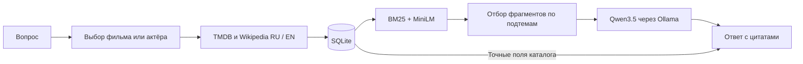

<p align="center">
  
</p>

<p align="center">
  
  
  
  
</p>

<p align="center">
  <strong>Русскоязычный сервис вопросов о фильмах, сериалах и актёрах.</strong><br>
  Найдите фильм или человека, задайте вопрос и откройте источник прямо из ответа.
</p>

<p align="center">
  <a href="demo/movie-rag-demo.mp4"><strong>▶ Смотреть демо</strong></a> ·
  <a href="#features"><strong>Возможности</strong></a> ·
  <a href="#architecture"><strong>Архитектура</strong></a> ·
  <a href="#start"><strong>Запуск</strong></a>
</p>

<p align="center">
  <a href="demo/movie-rag-demo.mp4">
    
  </a>
</p>

<a id="features"></a>
## Что реализовано

| Возможность | Как это работает |
| :-- | :-- |
| **Поиск по кино** | Автодополнение с постерами, фильтрами и годом выпуска. В каталоге можно выбрать фильм, сериал или актёра. |
| **Ответ на конкретный вопрос** | Короткие сведения берутся прямо из каталога. Для сюжета или биографии сервис ищет подходящие фрагменты и передаёт их локальной Qwen. |
| **Разбор вопросов из нескольких частей** | Для каждой подтемы подбираются свои материалы. Например, вопрос о том, кто снял фильм и кто написал музыку, возвращает оба факта. |
| **Источники рядом с ответом** | Номер в тексте ведёт к карточке с оригинальной страницей и фрагментами, которые получила модель. |
| **Локальная библиотека** | Материалы из TMDB и Wikipedia загружаются при первом выборе объекта. Документы и поисковый индекс переиспользуются в следующих запросах. |

### Что можно спросить

- **«Престиж»** · Как Борден выполнял трюк с телепортацией?
- **«Слово пацана. Кровь на асфальте»** · Кто такая Айгуль и как она связана с Маратом?
- **Джейсон Стейтем** · Каким видом спорта он занимался до кино?

<a id="architecture"></a>
## Как устроен поиск



**Индекс.** Тексты разбиваются на фрагменты с перекрытием. SQLite FTS5 ищет точные совпадения, многоязычный MiniLM — совпадения по смыслу. Ранги объединяются, а соседние предложения помогают сохранить контекст сцены.

**Генерация.** FastAPI отдаёт ответ по частям. Перед показом финального текста сервис проверяет номера ссылок и годы в цитируемых фрагментах. Если Ollama недоступна, интерфейс показывает выдержки из найденных материалов.

<a id="start"></a>
## Быстрый запуск

Установите Python 3.11+ и [Ollama](https://ollama.com/download). Для загрузки материалов понадобится [ключ TMDB](https://developer.themoviedb.org/docs/getting-started).

```bash
git clone https://github.com/dud0k3/movie-rag.git
cd movie-rag
python3 -m venv .venv
source .venv/bin/activate
pip install -e .
cp .env.example .env
```

В `.env` заполните `TMDB_API_KEY` или `TMDB_READ_ACCESS_TOKEN`. Для `WIKIMEDIA_CONTACT_URL` подойдёт ссылка на ваш профиль GitHub.

```bash
ollama pull qwen3.5:9b
uvicorn movie_rag.app:app
```

**[Открыть Киноархив](http://127.0.0.1:8000/)** · [Интерактивное API](http://127.0.0.1:8000/docs)

---

Учебный проект для **VK Education**. Источники данных — [TMDB](https://www.themoviedb.org/) и [Wikipedia](https://www.wikipedia.org/).

<sub>This product uses the TMDB API but is not endorsed or certified by TMDB.</sub>
